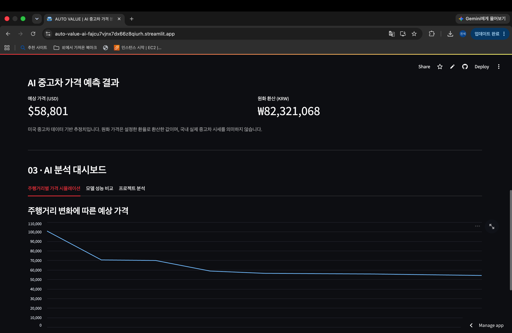
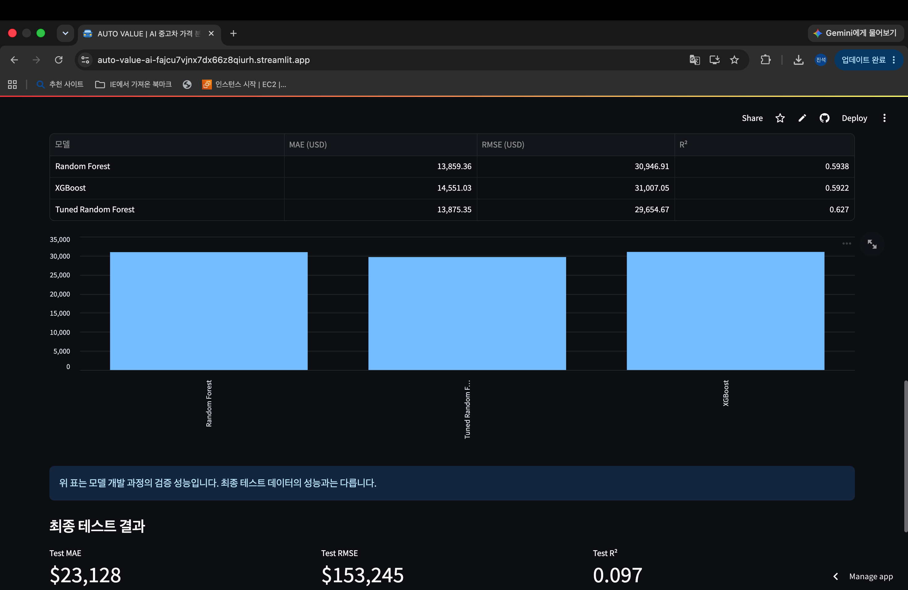

# 🚗 AUTO VALUE AI
### 머신러닝 기반 중고차 가격 예측 및 분석 시스템

## 0. 프로젝트 정보

| 항목 | 내용 |
|---|---|
| 학번 | 202337655 |
| 이름 | 오진석 |
| 프로젝트명 | AUTO VALUE AI |
| 프로젝트 유형 | 머신러닝 회귀 예측 및 웹서비스 |
| GitHub | https://github.com/jinseok0828/auto-value-ai |
| 배포 URL | https://auto-value-ai-fajcu7vjnx7dx66z8qiurh.streamlit.app/ |

## 1. 문제 정의

**Who — 누구를 위한 서비스인가?**

미국 중고차 구매를 고려하거나 차량의 예상 가격을 참고하려는 사용자를 대상으로 합니다.

**What — 어떤 문제를 해결하는가?**

중고차 가격은 브랜드, 연식, 주행거리, 사고 이력 등 다양한 조건에 따라 달라집니다. 이러한 정보를 머신러닝 모델에 입력하여 예상 가격을 제공하는 서비스를 구현했습니다.

**When — 언제 사용하는가?**

중고차 구매 전 차량 조건에 따른 예상 가격을 비교하거나 주행거리 변화가 가격에 미치는 영향을 확인할 때 사용할 수 있습니다.

**Why — 왜 필요한가?**

여러 차량 조건을 동시에 고려한 가격 추정 결과를 제공하여 사용자의 비교와 판단을 돕기 위해서입니다.

**차별점**

- 직접 학습한 머신러닝 모델을 웹서비스에 연동
- Random Forest와 XGBoost 성능 비교
- 하이퍼파라미터 튜닝 및 SHAP 기반 모델 해석
- 주행거리별 가격 시뮬레이션
- 가격 구간별 예측 오차 분석

**정량 목표**

검증 데이터에서 여러 모델의 MAE, RMSE, R²를 비교하고, 기준 모델 대비 예측 성능이 개선된 모델을 선택하는 것을 목표로 설정했습니다.

## 2. 데이터

**출처:** Kaggle — Used Car Price Prediction Dataset  
https://www.kaggle.com/datasets/taeefnajib/used-car-price-prediction-dataset

- 데이터 규모: 4,009개 차량
- 전체 컬럼: 12개
- 예측 대상: 중고차 가격(USD)
- 주요 입력 변수: 브랜드, 모델, 연식, 주행거리, 연료 종류, 변속기, 사고 이력 등
- 데이터 선택 이유: 차량의 여러 특성과 실제 가격 정보를 포함하고 있어 회귀 모델 학습과 비교 분석에 적합함

데이터의 세부 라이선스와 이용 조건은 Kaggle 원본 데이터셋 페이지를 기준으로 확인해야 합니다.

## 3. 데이터 전처리

다음과 같은 전처리 및 탐색적 데이터 분석을 수행했습니다.

1. 차량 가격 데이터를 수치형으로 변환
2. 범주형 및 수치형 변수 전처리
3. 차량 가격 분포 및 이상치 확인
4. 브랜드별 평균 가격 비교
5. 학습·검증·테스트 데이터 분리
6. 학습 데이터 기반 모델 훈련 및 검증 데이터 기반 모델 비교

가격 분포에서 일부 초고가 차량이 확인되었으며, 이러한 이상치가 전체 예측 오차에 미치는 영향을 추가로 분석했습니다.

전처리와 모델 학습의 구체적인 구현은 `used_car_prediction.ipynb`에서 확인할 수 있습니다.

## 4. 모델

**베이스라인 모델: Random Forest Regressor**

여러 의사결정나무의 예측을 결합하는 앙상블 모델로, 차량 특성과 가격 사이의 비선형 관계를 학습하기 위해 사용했습니다.

**비교 모델: XGBoost Regressor**

그래디언트 부스팅 기반 모델로, Random Forest와 예측 성능을 비교하기 위해 사용했습니다.

**개선 모델: Tuned Random Forest**

하이퍼파라미터를 조정하여 기본 Random Forest 대비 성능 개선을 시도했습니다.

최종 모델은 검증 데이터의 RMSE와 R²를 중심으로 비교하여 선택했습니다.

## 5. 평가 결과

### 검증 데이터 성능 비교

| 모델 | MAE (USD) | RMSE (USD) | R² |
|---|---:|---:|---:|
| Random Forest | 13,859.36 | 30,946.91 | 0.5938 |
| XGBoost | 14,551.03 | 31,007.05 | 0.5922 |
| Tuned Random Forest | 13,875.35 | 29,654.67 | 0.6270 |

튜닝 Random Forest는 기본 모델보다 RMSE가 감소하고 R²가 증가하여 최종 모델로 선정했습니다. 다만 MAE는 기본 Random Forest보다 소폭 높았습니다.

### 최종 테스트 성능

| 지표 | 결과 |
|---|---:|
| MAE | 23,127.73 USD |
| RMSE | 153,244.80 USD |
| R² | 0.097 |

검증 성능과 테스트 성능 사이에 차이가 발생했으며, 특히 극단적으로 가격이 높은 차량이 오차에 큰 영향을 주었습니다.

### 가격 구간별 오차 분석

| 가격 구간 | 차량 수 | MAE (USD) |
|---|---:|---:|
| 100,000달러 미만 | 566 | 10,545.49 |
| 100,000~500,000달러 | 33 | 55,147.83 |
| 500,000달러 초과 | 3 | 2,044,757.32 |

고가 차량일수록 예측 오차가 커지는 현상을 확인했습니다. 특히 500,000달러 초과 구간은 표본이 3개뿐이므로 일반화에 주의해야 합니다.

### 모델 해석 및 심화 분석

- Permutation Importance를 이용한 변수 중요도 분석
- SHAP을 이용한 예측 영향 분석
- 주행거리 변화에 따른 가격 시뮬레이션
- 가격 구간별 예측 오차 분석

주행거리, 브랜드, 연식 등 차량 특성이 가격 예측에 중요한 영향을 미치는 것으로 분석되었습니다.

## 6. 서비스 프로토타입

직접 학습한 머신러닝 모델을 Streamlit 웹 애플리케이션에 연동했습니다.

**주요 기능**

- 차량 정보 입력 및 예상 가격 예측
- USD 및 KRW 환산 가격 표시
- 주행거리별 예상 가격 시뮬레이션
- 머신러닝 모델 성능 비교
- 프로젝트 분석 결과 확인

원화 환산 결과는 설정된 환율에 따른 참고값이며 국내 중고차 실거래 가격을 의미하지 않습니다.

### 웹서비스 실행 화면

**1. 메인 화면**


**2. 가격 예측 결과**



**3. 분석 대시보드**



## 7. 배포

**배포 플랫폼:** Streamlit Community Cloud

**공개 URL:**  
https://auto-value-ai-fajcu7vjnx7dx66z8qiurh.streamlit.app/

**GitHub 저장소:**  
https://github.com/jinseok0828/auto-value-ai

웹사이트는 GitHub에 업로드한 소스코드와 학습 모델 파일을 사용하여 배포했습니다.

## 8. 실행 방법

**실행 환경**

- Python 3.12
- Streamlit
- Scikit-learn
- Pandas, NumPy
- Joblib

**설치**

```bash
pip install -r requirements.txt
```

**실행**

```bash
streamlit run app.py
```

**프로젝트 주요 파일**

```text
auto-value-ai/
├── app.py
├── requirements.txt
├── used_car_model.pkl
├── used_car_prediction.ipynb
├── used_cars.csv
├── screenshot1.png
├── screenshot2.png
├── screenshot3.png
└── README.md
```

## 9. Lessons Learned

### PMI 회고

**Plus — 잘된 점**

1. Random Forest와 XGBoost를 직접 학습하고 객관적인 평가 지표로 비교했습니다.
2. 모델 해석과 웹서비스 배포까지 구현하여 머신러닝 개발의 전체 과정을 경험했습니다.

**Minus — 아쉬운 점**

1. 고가 차량 이상치로 인해 최종 테스트 성능이 크게 저하되었습니다.
2. 일부 차량의 세부 사양과 시장 상황을 충분히 반영하지 못했습니다.

**Interesting — 흥미로웠던 점**

1. 검증 데이터에서 성능이 좋은 모델도 테스트 데이터에서는 다른 결과를 보일 수 있었습니다.
2. SHAP과 변수 중요도 분석을 통해 모델이 어떤 특성을 활용하는지 살펴볼 수 있었습니다.

### 문제 해결 사례

**사례 1 — 고가 차량으로 인한 예측 오차 증가**

- 문제: 테스트 데이터에서 RMSE가 크게 증가
- 분석: 차량 가격 구간별 오차를 분리하여 확인
- 결과: 극단적인 고가 차량에서 오차가 집중되는 현상을 발견
- 배운 점: 전체 평균 지표뿐 아니라 데이터 구간별 성능도 확인해야 함

**사례 2 — 웹서비스 실행 환경 호환성 문제**

- 문제: 모델과 웹 애플리케이션 배포 과정에서 패키지 및 Python 버전 호환성 문제 발생
- 해결: Python 실행 버전과 라이브러리 의존성을 조정
- 결과: Streamlit Community Cloud에 웹서비스 배포
- 배운 점: 모델 성능뿐 아니라 실행 환경 재현성도 중요함

### 향후 개선 계획

1. 고가 차량의 이상치 처리와 가격 변환 기법을 비교하여 예측 성능 개선
2. 차량 세부 사양 및 추가 데이터 확보를 통한 모델 재학습
3. 가격 구간별 모델 또는 추가 알고리즘을 실험하여 일반화 성능 비교

이번 프로젝트를 통해 데이터 전처리, 머신러닝 모델 학습, 성능 비교, 하이퍼파라미터 튜닝, 모델 해석, 웹 애플리케이션 구현 및 클라우드 배포까지 전체 개발 과정을 경험했습니다.
