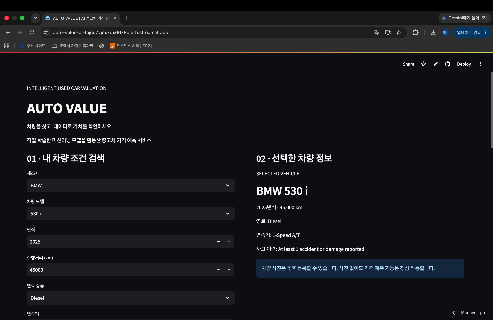

# 🚗 AUTO VALUE AI
### 머신러닝 기반 중고차 가격 예측 및 분석 시스템

## 1. 프로젝트 소개
AUTO VALUE AI는 미국 중고차 데이터를 활용하여 차량의 브랜드, 연식, 주행거리, 연료 종류, 변속기 및 사고 이력 등을 분석하고 예상 중고차 가격을 예측하는 머신러닝 웹 애플리케이션입니다.

직접 학습한 머신러닝 모델을 Streamlit 웹사이트에 연동하여 사용자가 차량 정보를 입력하면 예상 가격을 확인할 수 있도록 구현했습니다.

**배포 웹사이트:** https://auto-value-ai-fajcu7vjnx7dx66z8qiurh.streamlit.app

## 2. 사용 기술
- Python
- Pandas, NumPy
- Scikit-learn
- Random Forest Regressor
- XGBoost
- SHAP
- Streamlit
- Joblib
- GitHub

## 3. 데이터셋
- 출처: Kaggle — Used Car Price Prediction Dataset
- 데이터 규모: 4,009개 차량
- 주요 입력 변수: 브랜드, 모델 연식, 주행거리, 연료 종류, 변속기, 사고 이력
- 예측 목표: 중고차 가격(USD)

## 4. 데이터 분석 및 전처리
- 가격 데이터를 수치형으로 변환
- 범주형 및 수치형 변수 전처리
- 차량 가격 분포와 이상치 분석
- 브랜드별 평균 가격 비교
- 학습·검증·테스트 데이터 분리

## 5. 머신러닝 모델 비교

| 모델 | 검증 MAE | 검증 RMSE | 검증 R² |
|---|---:|---:|---:|
| Random Forest | 13,859.36 | 30,946.91 | 0.5938 |
| XGBoost | 14,551.03 | 31,007.05 | 0.5922 |
| Tuned Random Forest | 13,875.35 | 29,654.67 | 0.6270 |

검증 결과를 바탕으로 RMSE와 R²가 개선된 튜닝 Random Forest 모델을 최종 선택했습니다.

최종 테스트에서는 고가 차량 이상치의 영향으로 성능이 낮아졌으며, 이를 확인하기 위해 가격 구간별 오차를 추가 분석했습니다.

## 6. 모델 해석 및 심화 분석
- Permutation Importance를 통한 주요 변수 분석
- SHAP을 활용한 모델 예측 영향 분석
- 주행거리 변화에 따른 예상 가격 시뮬레이션
- 차량 가격 구간별 예측 오차 분석

특히 주행거리, 브랜드, 연식 등이 가격 예측에 중요한 영향을 미치는 것으로 분석되었습니다.

## 7. 웹사이트 주요 기능
- 차량 정보 입력 및 AI 예상 가격 계산
- 미국 달러(USD) 및 원화(KRW) 환산 표시
- 주행거리별 예상 가격 시뮬레이션
- 머신러닝 모델 성능 비교
- 프로젝트 분석 결과 확인

원화 환산은 사용자가 설정한 환율을 적용한 참고값이며, 국내 중고차 실거래 시세를 의미하지 않습니다.

### 웹사이트 실행 화면

**1. 메인 화면**



**2. 가격 예측 결과**


**3. 분석 대시보드**


## 8. 프로젝트 구조

```text
auto-value-ai/
├── app.py
├── requirements.txt
├── used_car_model.pkl
├── used_car_prediction.ipynb
├── used_cars.csv
└── README.md
```

## 9. 실행 방법

```bash
pip install -r requirements.txt
streamlit run app.py
```

## 10. 프로젝트 한계 및 개선 방향
- 고가 차량의 극단적인 가격으로 인해 전체 테스트 성능이 저하됨
- 일부 차량의 세부 사양을 충분히 반영하지 못함
- 미국 중고차 데이터 기반으로 국내 실거래 가격과 차이가 존재함
- 향후 데이터 확대, 이상치 처리 개선, 추가 변수 확보 및 모델 재학습 필요

## 11. 프로젝트를 통해 배운 점
데이터 전처리부터 머신러닝 모델 학습, 성능 비교, 하이퍼파라미터 튜닝, 모델 해석, 웹 애플리케이션 개발 및 클라우드 배포까지 전체 머신러닝 개발 과정을 경험했습니다.

특히 검증 데이터에서 우수한 결과를 보인 모델도 실제 테스트 데이터에서는 이상치와 데이터 분포의 영향으로 성능이 크게 달라질 수 있다는 점을 확인했습니다.
